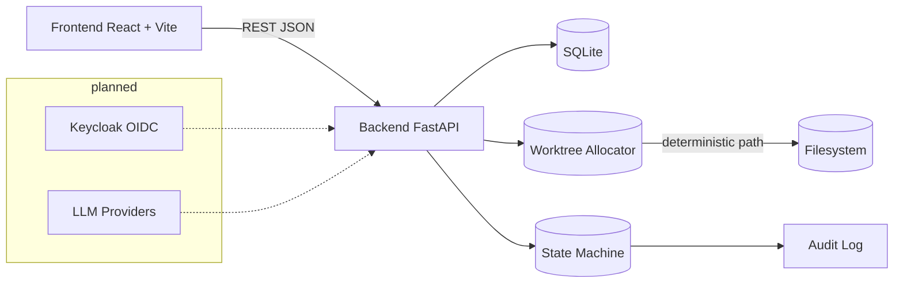

# Orbit Lab | Alan Vo | AI & Machine Learning

> Work in progress. This checkpoint may be incomplete or fail tests. See PLAN.md and STATUS.md before use.


Orbit Lab is an AI orchestrator for fleets of coding agents. The concrete problem it addresses is **fragmented agent execution**: when developers run multiple coding agents (Codex, Claude Code, OpenCode, etc.) against the same codebase, results scatter across terminals, diff views, and chat logs with no central tracking. Orbit Lab's approach is to provision an isolated git worktree per agent run, assign a deterministic worktree path via a content-derived allocation algorithm, and drive each run through an auditable state machine so outcomes remain comparable and reproducible. The intended user is any developer or team running more than one agent at a time and needing to compare results.

> **Round 1 complete:** This round delivers agent run management — create, list (with filtering and pagination), view details with full audit trail, and cancel runs. Each run is allocated a deterministic worktree path and driven through an auditable lifecycle state machine. Actual agent execution, OIDC authentication, and LLM provider adapters are planned milestones (see [STATUS.md](./STATUS.md)).

## AI/ML evaluation

| aspect | detail |
|--------|--------|
| Workflow | Deterministic worktree allocation → reproducible agent environments |
| Metric | State-machine transition correctness, audit-log completeness, path uniqueness |
| Data provenance | SQLite persistent store (`orbit_lab.db`) with UTC timestamps and audit trail |
| Baseline | 61 backend tests + 15 frontend tests, all passing |
| Limitations | No real agent execution; runs are tracked but not spawned |

**Reproduce:**

```bash
# Backend tests (domain + API boundary)
PYTHONPATH=backend .venv/bin/python -m pytest backend/tests -v

# Frontend tests (user-visible behavior)
cd frontend && npx vitest run

# Type safety
cd frontend && npx tsc --noEmit
```

**Measured results:** 61/61 backend tests pass; 15/15 frontend tests pass; `tsc --noEmit` clean. No benchmark numbers are claimed — the domain engine is deterministic and validated by unit tests, not statistical evaluation.

**Failure cases:** The worktree allocator rejects path-traversal attempts; the state machine rejects invalid transitions (e.g., completed → running). Future rounds will add execution and LLM adapter testing.

## Architecture



## Features

- **Agent run management** — Create runs with an agent identifier, repository URL, prompt, and optional branch. Each run is assigned a deterministic, unique worktree path.
- **Auditable lifecycle** — Runs transition through `pending → running → completed/failed/cancelled`. Every mutation is recorded in an audit log with UTC timestamps and actor context.
- **Worktree allocation engine** — Content-derived paths from repo URL and run ID, with collision detection and path-traversal protection.
- **Filtering & pagination** — List runs filtered by state or agent, with limit/offset pagination.
- **Web UI** — React dashboard with create form, run list, and detail view showing the full audit trail.

## Install

### Local development

```bash
# Backend
python3 -m venv .venv
.venv/bin/pip install -r backend/requirements.txt
# Set DATABASE_URL (defaults to sqlite:///./orbit_lab.db)
PYTHONPATH=backend .venv/bin/uvicorn app.main:app --host 127.0.0.1 --port 8000
PYTHONPATH=backend .venv/bin/python -m pytest backend/tests

# Frontend
cd frontend
npm install
npm run dev       # http://127.0.0.1:5173
npm run build
npx vitest run
```

### Docker

```bash
docker compose up --build
# Backend: http://127.0.0.1:8000
# Frontend: http://127.0.0.1:3000
# Keycloak: http://127.0.0.1:8080
```

## API endpoint reference

| Method | Path | Description |
|--------|------|-------------|
| `POST` | `/api/runs/` | Create a run (body: `agent`, `repo_url`, `prompt`, `branch?`) → 201 |
| `GET` | `/api/runs/` | List runs (query: `state?`, `agent?`, `limit=50`, `offset=0`) |
| `GET` | `/api/runs/{id}` | Get run detail with audit trail → 404 if not found |
| `POST` | `/api/runs/{id}/start` | Transition to `running` → 409 on invalid transition |
| `POST` | `/api/runs/{id}/complete` | Transition to `completed` |
| `POST` | `/api/runs/{id}/fail?error_message=...` | Transition to `failed` |
| `DELETE` | `/api/runs/{id}` | Cancel a pending/running run → 409 if terminal |
| `GET` | `/health` | Health check |

## Security limitations

- **Auth not yet implemented.** All API endpoints are currently open. OIDC via Keycloak is a planned milestone.
- **CORS** is permissive in development (`allow_origins=["*"]`). In production, configure specific origins.
- **No rate limiting** on API endpoints.
- **Worktree paths** are validated against path traversal, but actual worktree creation is not yet implemented.
- **Demo mode** is not yet implemented. When added, it will bind to `127.0.0.1` only and refuse to start in production.
- Never commit real credentials. See `.env.example` for the template.

## Provider configuration

LLM adapters (planned) will support:

| Provider | Configuration | Default |
|----------|--------------|---------|
| OpenAI-compatible | `LLM_API_KEY`, `LLM_PROVIDER=openai`, `LLM_MODEL=gpt-4o`, `LLM_BASE_URL` | — |
| Anthropic | `LLM_API_KEY`, `LLM_PROVIDER=anthropic`, `LLM_MODEL=claude-3-5-sonnet-20241022` | — |
| Gemini | `LLM_API_KEY`, `LLM_PROVIDER=gemini`, `LLM_MODEL=gemini-2.0-flash` | — |
| Ollama | `LLM_PROVIDER=ollama`, `LLM_MODEL=gemma2`, `LLM_BASE_URL=http://localhost:11434` | — |

`LLM_API_KEY` is the only secret. Keys are only used server-side. No real endpoints or keys are preset.

## SSO / SAML setup (planned)

Orbit Lab will support OIDC authorization-code login through Keycloak with state + nonce + PKCE. Keycloak can broker to upstream SAML IdPs. The realm import and SAML identity provider configuration will be documented in `docs/auth.md` once the auth milestone is implemented.

## Source layout

```
backend/
  app/
    main.py          FastAPI app factory
    core/
      config.py      Settings (SQLite, environment, LLM)
      database.py    SQLAlchemy engine, session factory
    models/
      run.py         Run model, state enum, transition logic
      audit.py       AuditLog model
    services/
      worktree.py    Worktree allocation engine
      run.py         Run lifecycle state machine
    api/
      runs.py        Run management REST endpoints
    schemas/
      run.py         Pydantic request/response schemas
  tests/
    conftest.py      Shared fixtures (in-memory SQLite)
    test_worktree_service.py  Allocation engine tests
    test_run_service.py       State machine / lifecycle tests
    test_api_runs.py          HTTP integration tests
  Dockerfile
  pyproject.toml
  requirements.txt

frontend/
  src/
    api/
      client.ts      Typed API client (derived from backend routes)
      types.ts       Domain types
    components/
      RunList.tsx    Run table with filtering
      RunForm.tsx    Create-run form
      RunDetail.tsx  Detail view with audit trail
      StateBadge.tsx  State label component
      RunStatusControls.tsx  Lifecycle transition buttons
    pages/
      RunsPage.tsx   Dashboard
      RunDetailPage.tsx Detail page
    hooks/
      useRuns.ts     Run data management hooks
    lib/
      format.ts      Formatting utilities
      runState.ts    State styling
  package.json
  vite.config.ts
  tsconfig.json
```

## Dependencies

- **Backend:** FastAPI, Uvicorn, SQLAlchemy, Pydantic Settings
- **Frontend:** React 18, TypeScript, Vite, React Router, Vitest, Testing Library

---

Orbit Lab — AI orchestrator for a fleet of coding agents.

Alan Vo <alanvo@gmail.com> | [MIT License](./LICENSE)